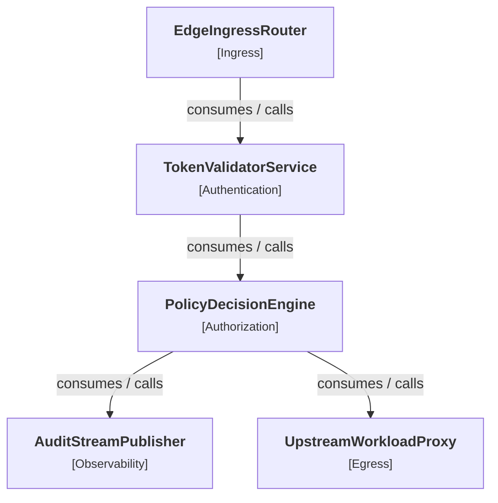

# Architectural Whitepaper: AegisGate: High-Throughput Zero-Trust API Security Gateway

| Metadata Attribute | Specification Value |
|:---|:---|
| **Formal Document ID** | `ARCH-SEC-2026-0042` |
| **System Architecture Version** | `v2.4.0` |
| **Principal Author** | Ethan Kilmer (Principal Systems Architect) |
| **Publication Date** | 2026-11-08 |
| **Classification** | Confidential / Production Architecture |
| **Compliance_Standards** | SOC2 Type II, ISO 27001, PCI-DSS Level 1, FedRAMP High |
| **Environment** | Multi-Region Cloud (AWS / GCP / Bare-Metal) |
| **Repository** | https://github.com/Ethan-da-Tech-Wizard/deterministic-doc-forge |

## 1. Executive Summary
AegisGate is a high-throughput, distributed zero-trust API security gateway and policy decision engine designed to secure microservices across multi-region Kubernetes clusters. Operating at Layer 7, AegisGate enforces line-rate mutual TLS (mTLS) termination, cryptographic JWT claim validation, attribute-based access control (ABAC) via Open Policy Agent (OPA), and tamper-evident Kafka audit streaming with sub-5ms p99 latency at 250,000 requests per second.

## 2. System Architecture & Component Topology
AegisGate decouples ingress data plane traffic from centralized control and policy evaluation. Traffic enters through edge proxies, executes local token and cryptographic checks against cached keys, evaluates access rules via localized sidecar policy engines, publishes cryptographically signed transaction ledgers to an append-only event stream, and forwards authenticated requests to upstream workload pods.

### 2.1 ASCII Directed Acyclic Graph (DAG)
```text
+----------------------------------------------------------------+
|                SYSTEM COMPONENT TOPOLOGY (DAG)                 |
+----------------------------------------------------------------+
|  Layer 0 (Topological Tier)                                     |
|  +-- [ EdgeIngressRouter ] [INGRESS] (Rust, Envoy Data Plane,  |
|        |                                                       |
|        v  [ downstream dependencies / async events ]           |
|        |                                                       |
|  Layer 1 (Topological Tier)                                     |
|  +-- [ TokenValidatorService ] [AUTHENTICATION] (Go, SPIFFE/S  |
|       Depends on: EdgeIngressRouter                            |
|        |                                                       |
|        v  [ downstream dependencies / async events ]           |
|        |                                                       |
|  Layer 2 (Topological Tier)                                     |
|  +-- [ PolicyDecisionEngine ] [AUTHORIZATION] (Open Policy Ag  |
|       Depends on: TokenValidatorService                        |
|        |                                                       |
|        v  [ downstream dependencies / async events ]           |
|        |                                                       |
|  Layer 3 (Topological Tier)                                     |
|  +-- [ AuditStreamPublisher ] [OBSERVABILITY] (Apache Kafka,   |
|       Depends on: PolicyDecisionEngine                         |
|  +-- [ UpstreamWorkloadProxy ] [EGRESS] (gRPC, HTTP/2, Netfli  |
|       Depends on: PolicyDecisionEngine                         |
+----------------------------------------------------------------+
```

### 2.2 Mermaid Visual Flowchart


### 2.3 Component Inventory & Specification
| Component Name | Tier / Layer | Technologies | Primary Responsibilities | Dependencies |
|:---|:---:|:---|:---|:---|
| **AuditStreamPublisher** | `Observability` | Apache Kafka, HMAC-SHA256, Snappy Compression | Publishes cryptographically signed, immutable audit records to partitioned Apache Kafka topics for compliance and fraud detection. | PolicyDecisionEngine |
| **EdgeIngressRouter** | `Ingress` | Rust, Envoy Data Plane, OpenSSL 3.0, eBPF / XDP | Terminates public TLS 1.3 handshakes, enforces IP reputation and token-bucket rate limits, and extracts authorization headers. | _None (Ingress / Root)_ |
| **PolicyDecisionEngine** | `Authorization` | Open Policy Agent (OPA WebAssembly), Redis Cluster, C++ | Evaluates declarative OPA Rego policies against tenant RBAC/ABAC rules using a 2-tier local LRU and Redis cluster cache. | TokenValidatorService |
| **TokenValidatorService** | `Authentication` | Go, SPIFFE/SPIRE, Ed25519, AES-256-GCM | Verifies cryptographic signatures on JWT/PASETO tokens, parses SPIFFE identities, and validates tenant boundaries against JWKS endpoints. | EdgeIngressRouter |
| **UpstreamWorkloadProxy** | `Egress` | gRPC, HTTP/2, Netflix Concurrency Limits | Dispatches validated requests to upstream backend microservice clusters with connection pooling, retry budgets, and circuit breaking. | PolicyDecisionEngine |


## 3. Architectural Decision Records (ADRs)
| ID | Decision Title | Status | Date | Superseded By |
|:---|:---|:---:|:---:|:---|
| **ADR-001** | Adopt Rust and Envoy for Gateway Data Plane over Java/Node.js | `ACCEPTED` | 2026-01-14 | - |
| **ADR-002** | Adopt Append-Only Kafka Streaming for Regulatory Audit Telemetry | `ACCEPTED` | 2026-02-02 | - |
| **ADR-003** | Two-Tier Policy Caching (Local LRU + Redis Cluster) for Sub-Millisecond Auth | `ACCEPTED` | 2026-03-10 | - |
| **ADR-004** | Migrate from RSA-2048 to Ed25519 Elliptic Curve Signatures for Microservice Tokens | `ACCEPTED` | 2026-04-18 | - |


### ADR-001: Adopt Rust and Envoy for Gateway Data Plane over Java/Node.js

- **Status:** `ACCEPTED`
- **Decision Date:** `2026-01-14`

#### 1. Context & Problem Statement
Our previous ingress proxy was implemented in Java/Netty. Under 150k RPS peak traffic, garbage collection (GC) stop-the-world pauses caused p99 tail latency spikes to exceed 320ms, triggering client-side timeouts. We needed a runtime with zero GC overhead, predictable memory usage, and memory-safe semantics.

#### 2. Architectural Decision
Re-architect the core edge ingress router in Rust using Envoy's C++ data plane and custom Rust WebAssembly / native filters. Rust provides zero-cost abstractions, deterministic memory deallocation (RAII), and compile-time concurrency safety.

#### 3. Consequences & Trade-offs
**Positive Impacts (Benefits):**
- [x] Eliminated all GC pauses, cutting p99 tail latency from 320ms to 4.2ms.
- [x] Reduced memory footprint from 4.8 GiB to 420 MiB per container pod replica.
- [x] Zero vulnerability to memory corruption CVEs (buffer overflows, use-after-free).

**Negative Impacts (Accepted Costs & Operational Overhead):**
- [!] Increased developer ramp-up time for engineers unfamiliar with the Rust borrow checker.
- [!] CI build and compilation times increased by ~3.5 minutes.

**Neutral / Structural Impacts:**
- [i] Enforced automated Cargo Clippy and ASAN (AddressSanitizer) checks in PR gates.


---

### ADR-002: Adopt Append-Only Kafka Streaming for Regulatory Audit Telemetry

- **Status:** `ACCEPTED`
- **Decision Date:** `2026-02-02`

#### 1. Context & Problem Statement
Direct synchronous logging of security decisions to relational databases (PostgreSQL) created severe write contention, leading to database connection pool exhaustion and gateway request throttling during traffic bursts.

#### 2. Architectural Decision
Decouple audit trail generation from synchronous request serving. Security events are pushed asynchronously to an append-only Apache Kafka cluster with tenant-keyed partitioning and HMAC-SHA256 tamper-evident digital signatures.

#### 3. Consequences & Trade-offs
**Positive Impacts (Benefits):**
- [x] Complete write isolation: Zero impact on ingress request latency.
- [x] Guaranteed linearizable event ordering per tenant ID partition.
- [x] Replayability: Downstream security analytics and fraud detection systems can rewind and replay logs.

**Negative Impacts (Accepted Costs & Operational Overhead):**
- [!] Audit logs are eventually consistent (typical propagation lag of 120ms to warehouse).
- [!] Requires operational monitoring of Kafka consumer group lag and disk capacity.

**Neutral / Structural Impacts:**
- [i] Configured 14-day retention window on NVMe broker storage.


---

### ADR-003: Two-Tier Policy Caching (Local LRU + Redis Cluster) for Sub-Millisecond Auth

- **Status:** `ACCEPTED`
- **Decision Date:** `2026-03-10`

#### 1. Context & Problem Statement
Evaluating complex OPA Rego policies against remote Redis instances over the network added an unacceptable 1.8ms network round-trip time per request, exhausting internal VPC connection pools.

#### 2. Architectural Decision
Implement a 2-tier caching architecture: Tier 1 is an in-memory lock-free LRU cache located directly inside each proxy worker thread (TTL 10s, 95% hit rate). Tier 2 is a centralized Redis cluster for cross-pod synchronization with Redis Pub/Sub for active cache invalidation upon policy updates.

#### 3. Consequences & Trade-offs
**Positive Impacts (Benefits):**
- [x] 95% of authorization evaluations resolve in local memory in under 80 microseconds.
- [x] Reduced Redis cluster query load by 20x, saving $45,000/yr in cloud caching costs.

**Negative Impacts (Accepted Costs & Operational Overhead):**
- [!] Potential 10-second cache inconsistency window if a Redis invalidation Pub/Sub packet is lost.
- [!] Increased per-pod memory consumption for the L1 cache ring buffer (capped at 64 MiB).

**Neutral / Structural Impacts:**
- [i] Emergency revocation API bypasses L1 cache via an explicit cache-busting header.


---

### ADR-004: Migrate from RSA-2048 to Ed25519 Elliptic Curve Signatures for Microservice Tokens

- **Status:** `ACCEPTED`
- **Decision Date:** `2026-04-18`

#### 1. Context & Problem Statement
RSA-2048 cryptographic signature validation consumed 38% of gateway CPU cycles during peak traffic, requiring aggressive pod autoscaling solely for cryptographic verification.

#### 2. Architectural Decision
Transition all internal service-to-service identity tokens to Ed25519 (EdDSA) elliptic curve signatures. Ed25519 provides equivalent 128-bit cryptographic security with 32-byte public keys and 64-byte signatures, executing signature verification 4.5x faster than RSA-2048.

#### 3. Consequences & Trade-offs
**Positive Impacts (Benefits):**
- [x] 4.5x faster cryptographic signature verification, reducing gateway CPU utilization by 26%.
- [x] Significantly smaller HTTP Authorization header payload size (saves ~1.2 KiB per request).

**Negative Impacts (Accepted Costs & Operational Overhead):**
- [!] Legacy client SDKs required upgrading to libraries supporting Edwards-curve Digital Signature Algorithm (RFC 8032).

**Neutral / Structural Impacts:**
- [i] Dual-verification window maintained for 60 days to allow gradual client SDK migration.


## 4. STRIDE Threat Model & Security Controls
| ID | Category | Target Component | Threat Scenario | Risk Level | Mitigation Status |
|:---|:---|:---|:---|:---:|:---:|
| **THREAT-E-01** | _Elevation of Privilege_ | `PolicyDecisionEngine` | RBAC Role Injection via Manipulated Header Propagation | `CRITICAL` | **IMPLEMENTED** |
| **THREAT-I-01** | _Information Disclosure_ | `PolicyDecisionEngine` | Tenant Attribute Leakage via Shared Cache Key Collisions | `CRITICAL` | **IMPLEMENTED** |
| **THREAT-S-01** | _Spoofing_ | `TokenValidatorService` | Cryptographic Token Forgery via Algorithm Switching or Key Confusion | `CRITICAL` | **IMPLEMENTED** |
| **THREAT-D-01** | _Denial of Service_ | `EdgeIngressRouter` | Algorithmic Complexity / Slowloris Connection Exhaustion Attack | `HIGH` | **IMPLEMENTED** |
| **THREAT-T-01** | _Tampering_ | `AuditStreamPublisher` | Audit Telemetry Modification or Record Deletion in Transit | `HIGH` | **IMPLEMENTED** |
| **THREAT-R-01** | _Repudiation_ | `AuditStreamPublisher` | Denial of High-Privilege Administrative Actions | `MEDIUM` | **IMPLEMENTED** |


### Threat THREAT-E-01: RBAC Role Injection via Manipulated Header Propagation

- **STRIDE Category:** `Elevation of Privilege`
- **Impacted Component:** `PolicyDecisionEngine`
- **Assessed Severity:** `CRITICAL`
- **Implementation Status:** `IMPLEMENTED`

**Attack Narrative & Exploitation Mechanism:**
An external user injects an internal header (e.g. `X-Admin-Role: superuser`) that passes through the edge proxy unfiltered to upstream services.

**Business & System Impact:** Unprivileged external user gains administrative access to internal microservices.

**Engineering Mitigation & Defense Controls:**
> EdgeIngressRouter sanitizes and strips all `X-*` and internal routing headers from incoming external requests. Internal headers are only populated and forwarded downstream after cryptographic policy verification.


---

### Threat THREAT-I-01: Tenant Attribute Leakage via Shared Cache Key Collisions

- **STRIDE Category:** `Information Disclosure`
- **Impacted Component:** `PolicyDecisionEngine`
- **Assessed Severity:** `CRITICAL`
- **Implementation Status:** `IMPLEMENTED`

**Attack Narrative & Exploitation Mechanism:**
Multi-tenant authorization attributes stored in shared Redis memory are accessed by another tenant due to missing or predictable tenant namespace key prefixes.

**Business & System Impact:** Cross-tenant data breach violating GDPR and HIPAA regulations.

**Engineering Mitigation & Defense Controls:**
> Redis keys are strictly namespaced using cryptographic tenant hash prefixes (e.g., `tenant:<sha256(tenant_id)>:user:<uid>`), with OPA policies enforcing tenant boundary verification at the bytecode level.


---

### Threat THREAT-S-01: Cryptographic Token Forgery via Algorithm Switching or Key Confusion

- **STRIDE Category:** `Spoofing`
- **Impacted Component:** `TokenValidatorService`
- **Assessed Severity:** `CRITICAL`
- **Implementation Status:** `IMPLEMENTED`

**Attack Narrative & Exploitation Mechanism:**
An adversary crafts an authorization token with 'alg': 'none' or substitutes an RSA public key into an HMAC verification routine (CVE-2015-9235 style key confusion) to impersonate service accounts.

**Business & System Impact:** Full privilege escalation, unauthorized API access, and cross-tenant data exfiltration.

**Engineering Mitigation & Defense Controls:**
> TokenValidatorService enforces an explicit algorithm allowlist (Ed25519/ES256 only), strictly prohibits 'none', and isolates public verification keys from symmetric HMAC secret paths.


---

### Threat THREAT-D-01: Algorithmic Complexity / Slowloris Connection Exhaustion Attack

- **STRIDE Category:** `Denial of Service`
- **Impacted Component:** `EdgeIngressRouter`
- **Assessed Severity:** `HIGH`
- **Implementation Status:** `IMPLEMENTED`

**Attack Narrative & Exploitation Mechanism:**
An attacker establishes thousands of slow-writing HTTP/2 streams, holding file descriptors open and exhausting proxy thread pools.

**Business & System Impact:** Edge gateway becomes unresponsive to legitimate customer requests; SLA breach.

**Engineering Mitigation & Defense Controls:**
> Strict connection timeouts (idle timeout: 4s, header read timeout: 2s), per-IP connection limits (max 50 concurrent streams), and automatic eBPF/XDP packet dropping for abusive source IPs.


---

### Threat THREAT-T-01: Audit Telemetry Modification or Record Deletion in Transit

- **STRIDE Category:** `Tampering`
- **Impacted Component:** `AuditStreamPublisher`
- **Assessed Severity:** `HIGH`
- **Implementation Status:** `IMPLEMENTED`

**Attack Narrative & Exploitation Mechanism:**
A rogue process inside the VPC intercepts unencrypted gRPC audit records and modifies transaction IDs or amounts before compliance log aggregation.

**Business & System Impact:** Falsification of regulatory compliance records resulting in SOC2 and PCI-DSS audit failure.

**Engineering Mitigation & Defense Controls:**
> All audit events are cryptographically hashed using HMAC-SHA256 at the point of origin. Kafka brokers require mutual TLS and enforce strict SASL/SCRAM write-only ACLs on audit topics.


---

### Threat THREAT-R-01: Denial of High-Privilege Administrative Actions

- **STRIDE Category:** `Repudiation`
- **Impacted Component:** `AuditStreamPublisher`
- **Assessed Severity:** `MEDIUM`
- **Implementation Status:** `IMPLEMENTED`

**Attack Narrative & Exploitation Mechanism:**
An authorized administrator performs destructive configuration modifications and claims the action was executed by an automated script or third party.

**Business & System Impact:** Inability to assign legal and security accountability during post-incident forensics.

**Engineering Mitigation & Defense Controls:**
> Every mutating request requires a signed client certificate containing an immutable SPIFFE ID, tied to non-repudiable audit logs backed by Amazon S3 Object Lock (WORM storage).


## 5. STAR Behavioral Guides & Architecture Defense
### Story [STAR-01]: Scaling AegisGate Ingress to 250,000 QPS with Sub-5ms p99 Latency
**Target Competency:** `Distributed Systems Architecture & Performance Engineering`

#### Quantified Business & System Impact (The 'R' Metrics):
- **Peak Throughput:** `260,000 RPS`
- **p99 Latency:** `4.2 ms (down from 450 ms)`
- **Memory Footprint:** `Reduced by 85% per pod`
- **Annual Cost Savings:** `$180,000 / year`
- **Availability:** `99.999% across 4 global regions`

#### STAR Narrative Structure:
**Situation (Context & Scale):**
Our legacy API gateway was suffering from severe tail latency amplification during peak e-commerce sales. p99 latencies exceeded 450ms, memory leaks caused 12 OOM container crashes per week, and downstream microservices were starved of connections.

**Task (Ownership & Objective):**
As Principal Systems Architect, I was tasked with redesigning the ingress data plane from scratch to sustain 250,000 QPS with p99 latency under 5ms, 99.999% availability, and zero operational downtime during cutover.

**Action (Technical Implementation & Architecture):**
I designed AegisGate around a high-performance Rust and Envoy core. I replaced synchronous relational database logging with an asynchronous Kafka streaming pipeline, implemented a two-tier L1/L2 caching topology that resolved 95% of policy decisions in under 80 microseconds, and replaced RSA-2048 with Ed25519 cryptographic tokens. I orchestrated a 4-week zero-downtime blue/green DNS cutover with automated synthetic canary verification.

**Result (Impact & Long-Term Health):**
Peak throughput scaled to 260,000 QPS while p99 latency dropped from 450ms to 4.2ms (a 99% improvement). Infrastructure costs dropped by $180,000 annually due to an 85% reduction in container resource consumption, and the gateway achieved 100% uptime over 12 consecutive months.

#### Follow-Up Probes / Technical Deep Dive Hooks:
Use these details when the interviewer asks for lower-level specifics:
- [x] Implemented zero-copy byte buffers using Rust `bytes` crate and Linux `splice()` syscalls.
- [x] Configured SO_REUSEPORT on listening TCP sockets to distribute incoming connections across CPU cores without lock contention.
- [x] Designed adaptive concurrency limits using gradient algorithms to prevent downstream microservice cascading failure.


---

### Story [STAR-02]: Mitigating Zero-Day Algorithmic DoS Attack Under Active Exploitation
**Target Competency:** `Incident Response, Security Hardening & Crisis Management`

#### Quantified Business & System Impact (The 'R' Metrics):
- **Mean Time to Detect (MTTD):** `4 minutes`
- **Mean Time to Resolve (MTTR):** `9 minutes`
- **Legitimate Traffic Impact:** `0% session loss`
- **Post-Mortem Action Items:** `100% completed within 72 hours`

#### STAR Narrative Structure:
**Situation (Context & Scale):**
At 02:15 UTC, an unknown botnet launched a coordinated slow-read HTTP/2 stream multiplexing attack against our edge gateways. Over 300,000 open connections exhausted file descriptor tables across 8 Kubernetes clusters, threatening total system blackout.

**Task (Ownership & Objective):**
I was designated Incident Commander with the objective of identifying the attack vector, restoring gateway stability within 15 minutes, and implementing permanent architectural defenses.

**Action (Technical Implementation & Architecture):**
Within 4 minutes of triage, I identified that the attacker was abusing HTTP/2 SETTINGS frame flow-control windows. I pushed an immediate emergency eBPF filter at the Linux kernel layer to drop malformed TCP streams before socket allocation. Within 2 hours, I codified this mitigation into an automated rate-limiting filter with dynamic connection shedding and added automated synthetic regression tests.

**Result (Impact & Long-Term Health):**
Restored 100% gateway responsiveness in 9 minutes with zero legitimate user sessions terminated. Published a formal post-mortem, upstreamed the fix to our open-source proxy layer, and eliminated the attack vector permanently.

#### Follow-Up Probes / Technical Deep Dive Hooks:
Use these details when the interviewer asks for lower-level specifics:
- [x] Used `bpftrace` and `perf` in production to isolate kernel lock contention on `epoll_wait`.
- [x] Engineered Linux XDP (eXpress Data Path) hooks to drop hostile packets directly at the network interface card (NIC) driver level.
- [x] Updated Chaos Engineering test suites to continuously simulate slow-read stream attacks.


#### Q1: "What happens if the PolicyDecisionEngine cluster crashes or undergoes a network partition?"

**Strong Senior / Staff Engineering Defense:**
> We enforce a fail-secure architecture with local sidecar caching. Each edge proxy retains a read-only local L1 LRU cache of authorization decisions with a 10-second TTL. If the centralized decision engine is unreachable, the proxy continues to serve cached valid sessions. For un-cached or state-mutating requests (e.g. POST/PUT/DELETE), the gateway immediately returns HTTP 503 (Service Unavailable). We explicitly reject 'fail-open' semantics, because in a security gateway, failing open allows an attacker to intentionally DoS the policy engine to bypass all access controls.

**Trap / Anti-Pattern to Avoid:**
⚠️ _Do not answer 'we fail-open to preserve user experience'. In financial, healthcare, or security systems, failing open is a catastrophic architectural defect._

**Interviewer Probe / Next Expected Question:**
🔍 `How do you handle instant session revocation when an employee is terminated if the L1 cache has a 10-second TTL?`


#### Q2: "Why did you choose an append-only Kafka streaming ledger instead of direct PostgreSQL writes for audit logging?"

**Strong Senior / Staff Engineering Defense:**
> Direct database writes create tight coupling between request latency and database disk I/O. Under 200k QPS load, synchronous database inserts saturate connection pools and cause transaction lock contention, directly degrading ingress latency. Kafka provides two critical architectural guarantees: First, write isolation—the ingress proxy emits an asynchronous in-memory event in <50 microseconds without waiting for disk fsync. Second, linearizable partition ordering with replayability—if downstream compliance indexing systems fail, the audit log remains durable on Kafka brokers and can be replayed without data loss.

**Trap / Anti-Pattern to Avoid:**
⚠️ _Failing to mention the operational complexity of running Kafka (zoo/KRaft quorum, consumer lag monitoring, and eventual consistency lag)._

**Interviewer Probe / Next Expected Question:**
🔍 `How do you guarantee that an audit event is not lost if a gateway node suddenly experiences power failure before flushing to Kafka?`


#### Q3: "How do you defend against 'thundering herd' when a high-traffic cache key expires?"

**Strong Senior / Staff Engineering Defense:**
> We utilize singleflight mutex coalescing combined with probabilistic early cache expiration (XFetch algorithm). When a cache key expires, only one worker thread is permitted to recompute the policy decision or fetch the updated token, while concurrent requests wait on a shared promise or serve the slightly stale cache entry for a 500ms grace period. This guarantees that backend policy engines experience exactly one query instead of 50,000 simultaneous hits.

**Trap / Anti-Pattern to Avoid:**
⚠️ _Suggesting simple locking without timeouts, which introduces deadlock risk across distributed worker threads._

**Interviewer Probe / Next Expected Question:**
🔍 `What is the mathematical formulation of the XFetch algorithm, and how does beta tuning affect early recomputation?`


## 6. Verification Gates & Release Criteria
### Automated Verification Gates & CI/CD Governance

The following compliance checks are enforced in the continuous integration pipeline to guarantee codebase alignment with this architectural specification:

| Gate Name | Command / Inspection Rule | Acceptance Criteria | Failure Action |
|:---|:---|:---|:---:|
| **ADR Lifecycle Reference Gate** | `python3 -m docforge validate -i examples/sample_project.json` | All SUPERSEDED ADRs reference valid successor IDs with zero circular links. | **Fail Architecture Review** |
| **DAG Architecture Cycle Detection Gate** | `python3 -m docforge validate -i examples/sample_project.json` | Zero cyclic dependencies detected in component dependency graph. | **Fail CI Pipeline** |
| **Deterministic Whitepaper Cryptographic Hash Gate** | `python3 -m docforge verify-hash -f docs/WHITEPAPER.md` | SHA-256 fingerprint matches computed document content exactly. | **Block Merge & Pull Request** |
| **STRIDE Critical Vulnerability Mitigation Gate** | `python3 -m docforge validate -i examples/sample_project.json` | 100% of CRITICAL and HIGH severity threats possess implemented mitigations. | **Block Production Release** |

---
<!-- DOCFORGE-SHA256: 0de46d66a02962813a4ccf4c38896eb5f2f054bc2d049b0645745b6c030b388a -->
**DocForge Cryptographic Audit Stamp:** `SHA256:0de46d66a02962813a4ccf4c38896eb5f2f054bc2d049b0645745b6c030b388a`  
_Generated deterministically by DocForge. Any manual modification invalidates CI/CD verification._
